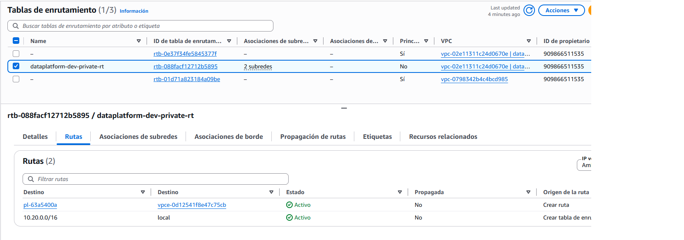
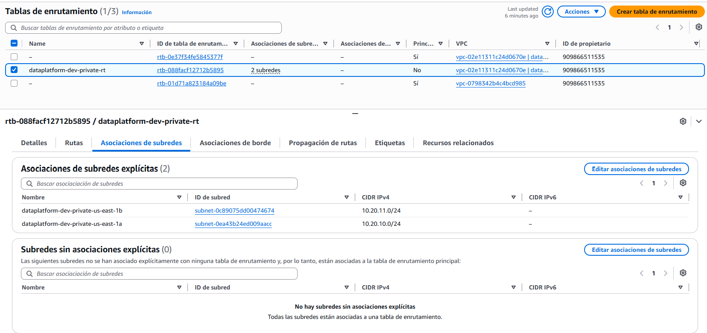

# Pre-entrega 1 — Infraestructura base con entorno de desarrollo e IAM core

Andamiaje base de una plataforma de datos en AWS, gestionado 100% con Terraform. Incluye backend remoto con locking, una VPC de datos privada con acceso a S3 por la red interna de AWS, un bucket de Data Lake y los roles IAM que usarán los servicios de procesamiento en las próximas entregas.

## Arquitectura

```
                         ┌──────────────────────────── Cuenta AWS (us-east-1) ────────────────────────────┐
                         │                                                                                │
 terraform (CLI / CI) ──►│  bootstrap/                                                                    │
                         │   ├─ S3  dataplatform-tfstate-<account>   (state: SSE, versionado, sin público) │
                         │   └─ DynamoDB  dataplatform-tf-locks      (state locking)                       │
                         │                                                                                │
                         │  environments/dev/                                                             │
                         │   ├─ module.network                                                            │
                         │   │    VPC 10.20.0.0/16 ─┬─ subred privada AZ-a 10.20.10.0/24                  │
                         │   │                      └─ subred privada AZ-b 10.20.11.0/24                  │
                         │   │    tabla de rutas privada: local + S3 Gateway Endpoint (sin IGW / NAT)     │
                         │   ├─ module.storage                                                            │
                         │   │    S3 dataplatform-dev-datalake-<account>  (objetos solo vía VPC Endpoint) │
                         │   └─ module.identity                                                           │
                         │        rol ingest-exec  (Lambda: List/Get/Put sobre raw/)                      │
                         │        rol auditor      (solo lectura de configuración, requiere MFA)          │
                         └────────────────────────────────────────────────────────────────────────────────┘
```

Flujo de outputs entre módulos (sin IDs ni ARNs hardcodeados):

```
network.s3_endpoint_id ──► storage.allowed_vpce_id
storage.bucket_arn / data_prefix ──► identity.data_bucket_arn / data_prefix
network.vpc_id, private_subnet_ids, identity.*_role_arn ──► outputs del entorno ──► próxima pre-entrega
```

## Estructura del repositorio

```
.
├── bootstrap/                 # Root module 1: crea el backend (bucket de state + tabla de locks)
│   ├── main.tf
│   ├── variables.tf
│   ├── outputs.tf
│   └── backend.hcl.example    # plantilla de configuración del backend (backend.hcl no se versiona)
├── modules/                   # Módulos reutilizables: no conocen el entorno, todo entra por variables
│   ├── network/               # VPC, subredes privadas, tabla de rutas, S3 Gateway Endpoint
│   ├── storage/               # Bucket del Data Lake con hardening
│   └── identity/              # Rol de ejecución y rol de auditoría
├── environments/
│   └── dev/                   # Root module 2: invoca los módulos con los valores de dev
│       ├── backend.tf         # backend "s3" {} (configuración parcial)
│       ├── providers.tf       # versiones + provider AWS con default_tags
│       ├── main.tf            # llamadas a los módulos
│       ├── variables.tf       # environment, region, vpc_cidr, project_name (tipadas y validadas)
│       ├── terraform.tfvars   # valores de dev
│       ├── outputs.tf
│       └── backend.hcl.example
├── docs/                      # capturas de verificación
├── PLAN_OUTPUT.md
└── README.md
```

**Por qué esta separación:** los módulos son "recetas" y los entornos son quienes las usan. `modules/network` no sabe si corre en dev o en prod; solo `environments/dev/` contiene valores propios del entorno. Agregar prod es crear `environments/prod/` con otro `terraform.tfvars` y otro backend, sin tocar los módulos.

## Requisitos

- Terraform >= 1.5
- AWS CLI v2 configurada con un **usuario IAM** (nunca el usuario root): `aws configure` y verificar con `aws sts get-caller-identity`
- Permisos para crear S3, DynamoDB, VPC e IAM en la cuenta

## Despliegue paso a paso

### 1. Bootstrap del backend (una sola vez)

El backend no puede crearse desde el mismo proyecto que lo usa (Terraform necesita el bucket para guardar su state), por eso vive en un root module separado.

```bash
cd bootstrap
terraform init
terraform apply            # crea el bucket de state y la tabla de locks
```

Luego se migra el state del propio bootstrap al bucket recién creado:

```bash
cp backend.hcl.example backend.hcl    # completar <ACCOUNT_ID>
terraform init -backend-config="backend.hcl" -migrate-state   # responder "yes"
terraform plan                                                # debe decir "No changes"
```

### 2. Entorno dev

```bash
cd ../environments/dev
cp backend.hcl.example backend.hcl    # completar <ACCOUNT_ID>
terraform init -backend-config="backend.hcl"
terraform validate
terraform plan
terraform apply
```

> **Configuración parcial del backend:** el bloque `backend` no admite variables, por lo que los valores concretos (bucket con el ID de cuenta, key, tabla) viven en `backend.hcl`, que está en `.gitignore`. El repositorio solo incluye `backend.hcl.example`.

## Recursos creados

| Root module | Recurso | Propósito |
|---|---|---|
| bootstrap | S3 `dataplatform-tfstate-<account>` | State remoto. Versionado, SSE (AES256), Block Public Access, solo HTTPS, `prevent_destroy` |
| bootstrap | DynamoDB `dataplatform-tf-locks` | State locking (`LockID`), on-demand, PITR y cifrado |
| dev / network | VPC `10.20.0.0/16` | Red de datos con DNS habilitado |
| dev / network | 2 subredes privadas (2 AZs) | Cómputo futuro (Lambda/Flink); sin IP pública |
| dev / network | Tabla de rutas privada | Solo ruta local + S3; **sin Internet Gateway ni NAT** |
| dev / network | S3 Gateway Endpoint | Acceso a S3 por la red de AWS: sin NAT, sin costo, baja latencia |
| dev / network | Security group por defecto sin reglas | Nada lanzado "por defecto" queda expuesto |
| dev / storage | S3 `dataplatform-dev-datalake-<account>` | Data Lake. Versionado, SSE, Block Public Access, solo HTTPS, objetos solo vía VPC Endpoint |
| dev / identity | Rol `dataplatform-dev-ingest-exec` | Rol de ejecución para Lambda |
| dev / identity | Rol `dataplatform-dev-auditor` | Rol de auditoría de solo lectura |

### Verificación del Gateway Endpoint

La asociación con las subredes privadas se verifica en **VPC → Tablas de rutas → `dataplatform-dev-private-rt`**: la pestaña *Rutas* muestra la prefix list de S3 (`pl-…`) con destino al endpoint (`vpce-…`), y la pestaña *Asociaciones de subred* muestra ambas subredes privadas.




## Diseño IAM (mínimo privilegio)

### Rol de ejecución — `dataplatform-dev-ingest-exec`

- **Trust policy:** solo `lambda.amazonaws.com`, con condición `aws:SourceAccount` igual a la cuenta (previene *confused deputy*).
- **Permisos (únicamente los tres que pide la consigna, sobre un prefijo):**

| Acción | Recurso | Cómo se acota |
|---|---|---|
| `s3:ListBucket` | ARN del bucket del Data Lake | Condición `s3:prefix` = `raw/`, `raw/*` |
| `s3:GetObject`, `s3:PutObject` | `arn:aws:s3:::<datalake>/raw/*` | Prefijo en el ARN |

- No tiene acceso al bucket del state ni a otros prefijos. No puede borrar objetos ni crear o modificar recursos.
- Política administrada (`aws_iam_policy` + attachment), no inline, para versionarla y auditarla de forma independiente.

### Rol de auditoría — `dataplatform-dev-auditor`

- **Trust policy:** identidades de la propia cuenta, **solo con MFA** (`aws:MultiFactorAuthPresent = true`).
- **Permisos de solo lectura de configuración**, nunca de datos:

| Ámbito | Acciones | Recurso |
|---|---|---|
| Red | `ec2:DescribeVpcs`, `DescribeSubnets`, `DescribeRouteTables`, `DescribeVpcEndpoints`, `DescribeSecurityGroups` | `*` acotado por `aws:RequestedRegion` (ver nota) |
| Buckets | `s3:GetBucketPolicy`, `GetBucketVersioning`, `GetEncryptionConfiguration`, `GetBucketPublicAccessBlock`, `GetBucketTagging`, `GetBucketLocation` | Bucket del Data Lake y bucket del state |
| Locking | `dynamodb:DescribeTable` | Tabla de locks |
| IAM | `iam:GetRole`, `ListAttachedRolePolicies`, `ListRolePolicies`, `GetPolicy`, `GetPolicyVersion`, `ListPolicyVersions` | Roles y políticas con prefijo `dataplatform-dev-*` |

> **Nota sobre `*`:** las acciones `ec2:Describe*` no admiten permisos a nivel de recurso en AWS; es la única excepción y corresponde a acciones de **solo lectura**, restringidas además a la región del entorno. Ninguna acción de escritura usa `Resource: "*"`. El auditor no tiene `s3:GetObject` ni `s3:ListBucket`: verifica configuración, no lee datos.

## Outputs (inputs de la próxima pre-entrega)

| Output | Descripción |
|---|---|
| `vpc_id` | ID de la VPC de datos |
| `private_subnet_ids` | IDs de las subredes privadas |
| `s3_endpoint_id` | ID del S3 Gateway Endpoint |
| `data_lake_bucket_name` | Bucket del Data Lake |
| `exec_role_arn` | ARN del rol de ejecución |
| `audit_role_arn` | ARN del rol de auditoría |

```bash
cd environments/dev
terraform output
```

## Cómo extender a prod

1. Cuenta AWS separada para prod (aislamiento total del state y de los permisos).
2. Ejecutar el mismo `bootstrap/` con credenciales de la cuenta prod (ej. `AWS_PROFILE=prod`) para crear su propio bucket y tabla.
3. Crear `environments/prod/` copiando `environments/dev/`, con su `terraform.tfvars` (ej. otro `vpc_cidr`, `az_count = 3`) y su `backend.hcl` (`key = "prod/terraform.tfstate"`).
4. Los módulos no se modifican.

## Validación de calidad

```bash
terraform fmt -recursive -check
terraform validate
tflint --recursive        # opcional
```

## Decisiones, limitaciones y próximos pasos

- **Locking con DynamoDB:** la consigna lo exige. Terraform ≥ 1.11 marca `dynamodb_table` como deprecado en favor del lock nativo de S3 (`use_lockfile = true`); el `init` muestra ese warning. Migrar no cambia el resto del diseño.
- **Cifrado SSE-S3 (AES256):** cumple el requisito de cifrado del lado del servidor. En prod se usaría SSE-KMS con una CMK propia para controlar y auditar el uso de la llave.
- **Rol de ejecución acotado a la consigna:** cuando la Lambda exista (próxima entrega) necesitará además permisos de CloudWatch Logs y de creación de interfaces de red en la VPC. Se agregarán como una política adicional sobre el mismo rol (output `exec_role_name`), sin ampliar la política de S3.
- **Acceso a objetos solo vía VPC Endpoint:** subir archivos al Data Lake desde fuera de la VPC (ej. `aws s3 cp` desde una laptop) devuelve `AccessDenied` por diseño. Servicios administrados que escriban desde fuera de la VPC (ej. Kinesis Firehose) requerirán una excepción explícita en la bucket policy.
- **Service roles vs. service-linked roles:** los roles de este repositorio son *service roles* (los define el usuario y los asume un servicio). Los *service-linked roles* los crea y gestiona AWS.

## Limpieza

```bash
cd environments/dev
terraform destroy          # elimina red, Data Lake (vacío) y roles
```

El bootstrap tiene `prevent_destroy` en el bucket del state para evitar borrar por error la "memoria" de la infraestructura. Se elimina solo de forma deliberada, quitando esa protección.
